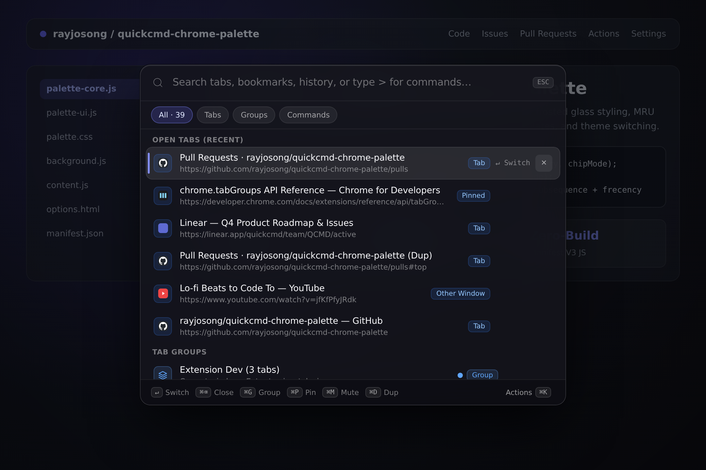
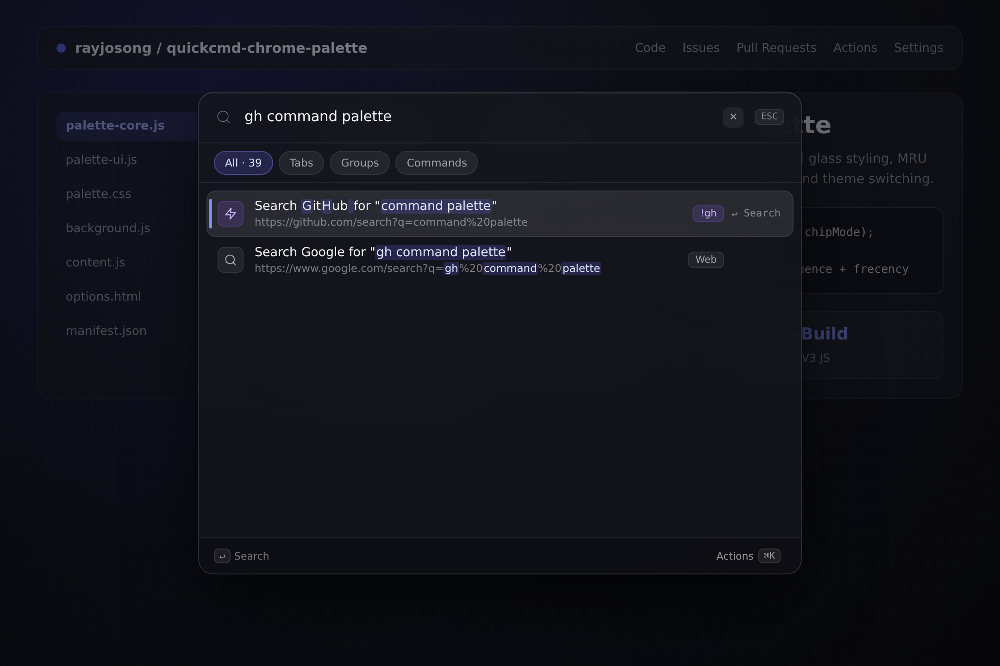
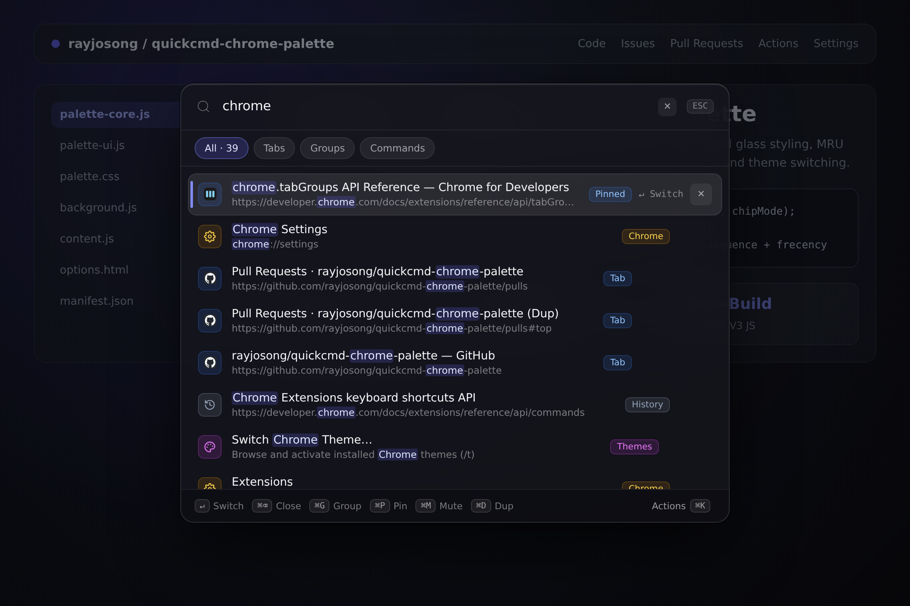
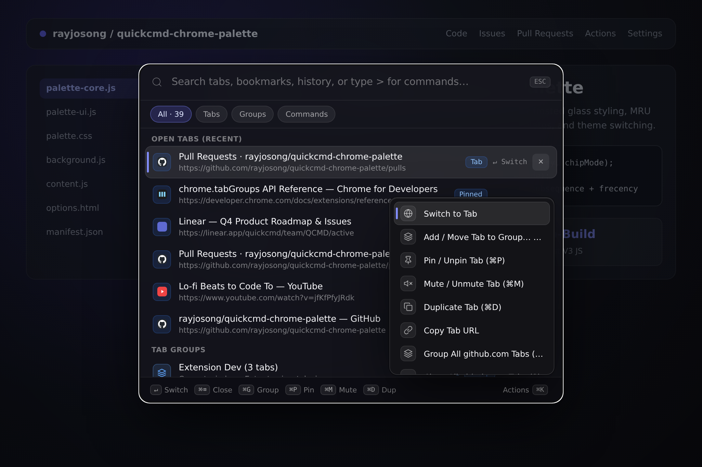
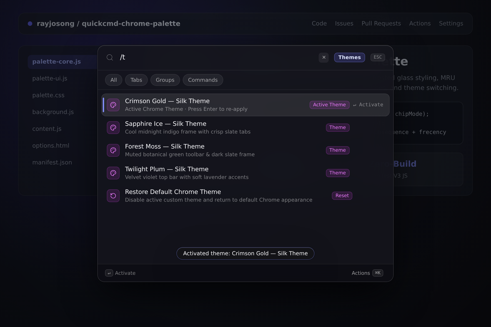

# Cue — Chrome Command Palette

A fast, no-frills Manifest V3 command palette for Google Chrome (`⌘⇧K` / `Ctrl+Shift+K`) — no account, no integrations, tabs, bookmarks, and history never leave Chrome. Built for company computers as much as personal ones. Featuring Dark Indigo Glass & Adaptive Light UI, MRU tab switching, interactive tab groups, custom bangs, and optional Chrome theme switching.

---

## Favourite Use Cases

See **[Favourite Use Cases](docs/FAVOURITE_USECASES.md)** for everyday power workflows (deduping, auto-grouping, tab suspension, Markdown/clean URL export, bookmark archiving, tab splitting, website cleanup) and CI/CD documentation.

---

## UI & Appearance

### Dark Indigo Glass


### Adaptive Light Mode


---

## Features & UX

### Bang Search Templates (`gh <query>`)


### Fuzzy Search & Match Highlighting


### Interactive Tab Group Picker (`⌘G`)


### Commands, Domain Actions & Duplicate Cleanup (`>`)


### Secondary Actions Popover (`⌘K`)


### Chrome Theme Switcher (`/t`) & Inline Toasts


### Quick Links & Bangs Options


---

## Shortcuts & Prefixes

| Shortcut | Action |
| :--- | :--- |
| `⌘⇧K` / `Ctrl+Shift+K` | Toggle palette |
| `Tab` / `Shift+Tab` | Cycle filter chips (or group colors) |
| `⌘K` / `Ctrl+K` | Actions menu |
| `⌘⌫` / `Ctrl+Bksp` | Close tab |
| `⌘G` / `Ctrl+G` | Add tab to group |
| `⌘P` / `Ctrl+P` | Pin / unpin tab |
| `⌘M` / `Ctrl+M` | Mute / unmute tab |
| `⌘D` / `Ctrl+D` | Duplicate tab |
| `Esc` | Exit sub-mode / close |

| Prefix | Mode |
| :--- | :--- |
| `>` | Commands & `chrome://` pages |
| `@` | Open tabs |
| `*` | Bookmarks |
| `/h` | History (30 days) |
| `/g` | Tab groups |
| `/c` | Recently closed |
| `/a` | Archived tabs (persistent, like Arc) |
| `/t` | Chrome themes (optional — needs the `management` permission, granted in Options) |

---

## Privacy & Permissions

- **No account, no sign-in, no analytics.** Cue runs entirely on your device — tabs, bookmarks, and history never leave Chrome.
- **No third-party integrations, by design.** No Notion, Figma, Google Docs, or any other service is connected. Browsing data stays in the browser.
- **Minimal permissions.** The extension asks only for what the palette needs (tabs, bookmarks, history, storage). Chrome theme switching (`/t`) is opt-in: it needs the `management` permission, which can also enable or disable other extensions, so it is requested only when you enable theme switching in Options — everything else works without it.

---

## Install

1. Download the latest `cue-chrome-palette-v*.zip` from the [Releases](https://github.com/rayjosong/cue-chrome-palette/releases) page and unzip it (or clone this repository).
2. Open `chrome://extensions` in Google Chrome.
3. Enable **Developer mode**.
4. Click **Load unpacked** and select the unzipped folder.
5. Press **`⌘ + Shift + K`** (or **`Ctrl + Shift + K`**) on any page, or click the toolbar icon on `chrome://` pages.

## Feedback, Issues & Support

- **Share / Star:** [github.com/rayjosong/cue-chrome-palette](https://github.com/rayjosong/cue-chrome-palette)
- **Report a bug or request a feature:** [Open an issue on GitHub](https://github.com/rayjosong/cue-chrome-palette/issues)
- **Support Cue:** [Buy Me a Coffee](https://buymeacoffee.com/crimpkey)
- You can also jump straight to the GitHub repo, Issues page, or Buy Me a Coffee from inside Cue via the footer icons, **Options → About, Feedback & Share**, or `> report issue` / `> github` / `> coffee`.

## Tests

```bash
node --test tests/*.test.js
```


