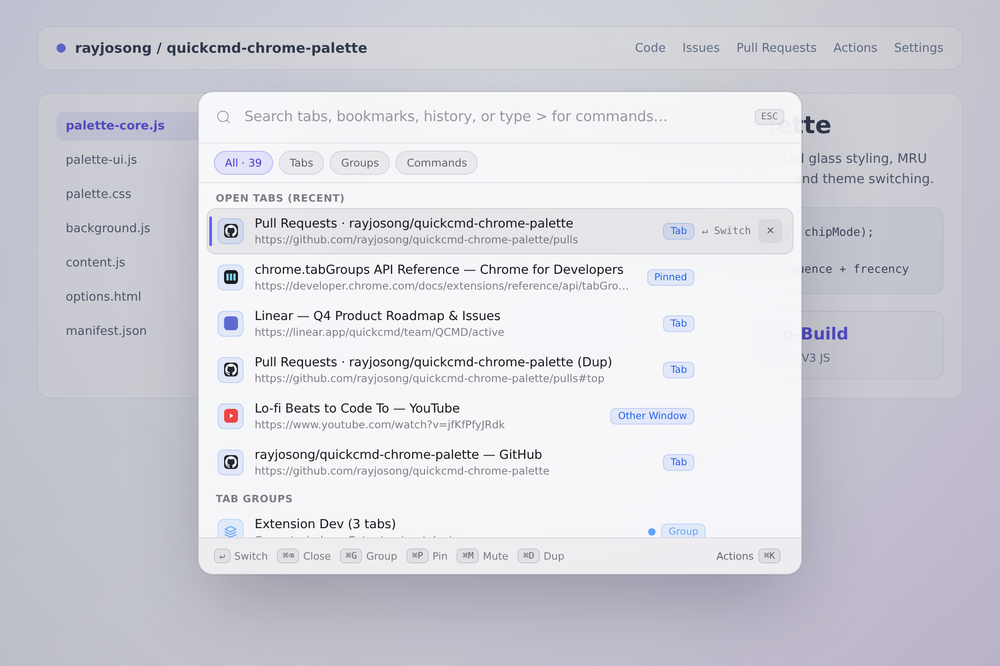
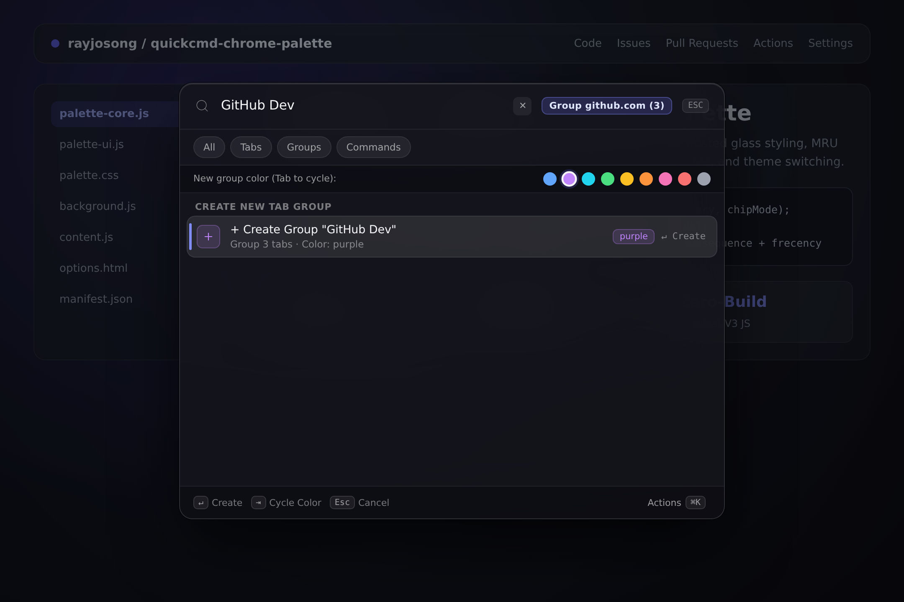
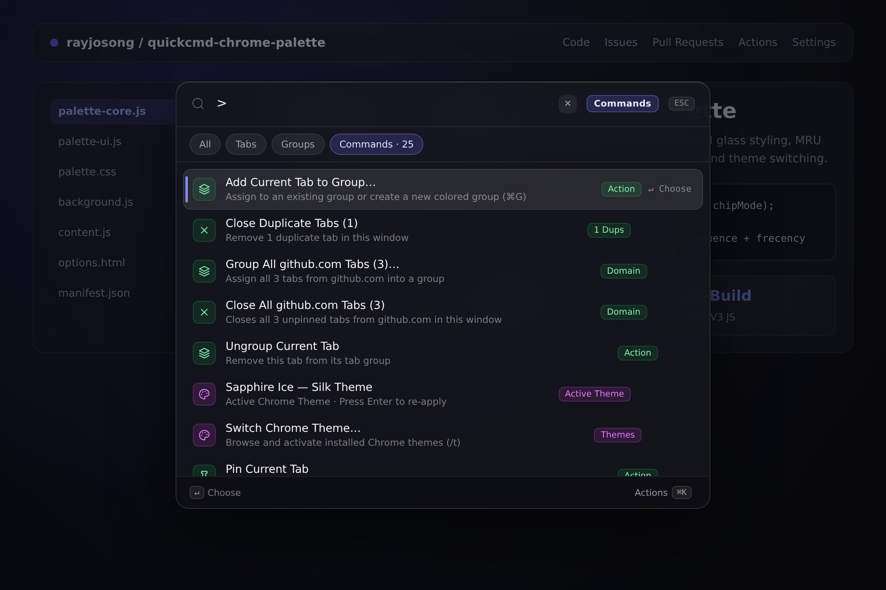
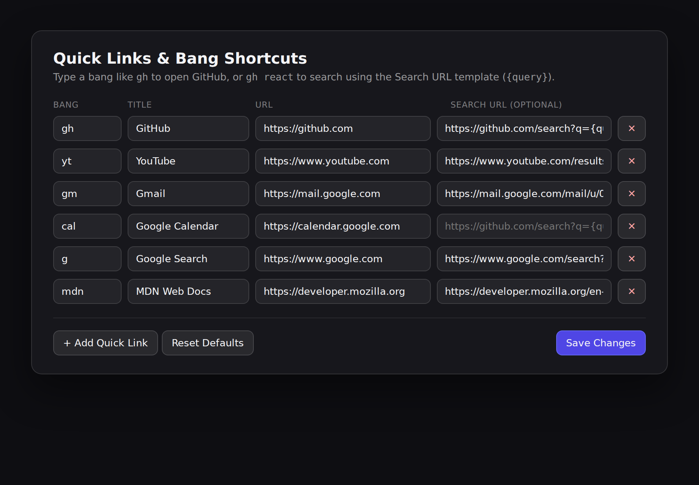

# QuickCmd — Chrome Command Palette

A lightweight, zero-build **Manifest V3** command palette for Google Chrome with a **Dark Indigo Glass** aesthetic (inspired by Raycast, Linear, Arc, VS Code Quick Open, and `cmdk`) and automatic **Adaptive Light Mode**.

Press **`⌘⇧K`** (macOS) or **`Ctrl+Shift+K`** (Windows/Linux) on any page to fuzzy-search open tabs, manage Chrome Tab Groups, restore recently closed sessions, trigger custom bang templates, switch Chrome themes, or run browser actions without leaving the keyboard.

---

## Visual Overview & UI Design

QuickCmd injects into a Shadow DOM host (`#quickcmd-shadow-host`) with `all: initial` CSS isolation so host-page styles never bleed in, and falls back seamlessly to a matching `650×520` toolbar popup (`popup.html`) on restricted `chrome://` or Chrome Web Store pages.

### Dark Indigo Glass (Default Zero-Query State)


### Adaptive Light Theme (`prefers-color-scheme: light`)


### UI Architecture & Design Tokens

| Layer / Token | Dark Mode | Light Mode | Purpose |
| :--- | :--- | :--- | :--- |
| **Backdrop (`qc-backdrop`)** | Radial dark vignette (`rgba(16,16,24,0.42)` → `rgba(6,6,10,0.62)`) | Soft slate vignette (`rgba(60,60,80,0.18)` → `rgba(40,40,60,0.28)`) | Centers attention away from busy webpages |
| **Modal Container (`qc-modal`)** | `rgba(21, 21, 27, 0.88)` + `blur(28px) saturate(180%)` | `rgba(255, 255, 255, 0.84)` + `blur(28px) saturate(180%)` | Centered `min(650px, 92vw)` × `min(520px, 86vh)` frosted card, `16px` radius, top specular inset highlight |
| **Active Selection Bar** | `#818cf8` (`2.5px` left bar) + `rgba(255,255,255,0.095)` row fill | `#6366f1` (`2.5px` left bar) + `rgba(20,20,30,0.07)` row fill | Instant focal anchor with right-aligned `↵ <Verb>` hint |
| **Search Row (`qc-search-row`)** | `15.5px` auto-focused input, clear button (`✕`), active **Mode Pill**, `ESC` cap | Same hierarchy with high-contrast `#17171c` ink | Zero-latency filtering & prefix feedback |
| **Filter Chips (`qc-chips`)** | Pill bar: `All · N`, `Tabs`, `Groups`, `Commands` | Tonal indigo active pill (`rgba(99,102,241,0.14)`) | Clickable or cyclable via `Tab` / `Shift+Tab` |
| **Contextual Footer (`qc-footer`)** | `rgba(12,12,16,0.62)` strip with `<kbd>` hints + `Actions ⌘K` button | `rgba(20,20,30,0.04)` strip | Hints adapt dynamically to the selected row or sub-mode |

### Semantic Icon & Badge Palette

Each result category renders a `26×26px` rounded icon tile (`7px` radius) and matching pill badge for instant visual scanning:

| Category | Icon & Badge Color | Examples |
| :--- | :--- | :--- |
| **Tabs** | Blue (`#93c5fd` / `#2563eb`) | `Tab`, `Pinned`, `Other Window` |
| **Tab Groups** | Dynamic Chrome group color (`blue`, `purple`, `cyan`, `green`, `yellow`, `orange`, `pink`, `red`, `grey`) | `Group`, `Collapsed`, `Assign` |
| **Bangs & Quick Links** | Violet (`#c4b5fd` / `#7c3aed`) | `!gh`, `!yt`, `!gm`, `!mdn` |
| **Actions** | Green (`#86efac` / `#16a34a`) | `Action`, `Domain`, `Cleanup`, `Settings` |
| **Chrome & Closed** | Amber (`#fcd34d` / `#b45309`) | `Chrome`, `Closed` |
| **Bookmarks** | Pink (`#f9a8d4` / `#db2777`) | `Bookmark` |
| **History** | Slate (`#94a3b8` / `#475569`) | `History` |
| **Chrome Themes** | Fuchsia (`#e879f9` / `#a21caf`) | `Active Theme`, `Theme`, `Reset` |

---

## Functionalities

### 1. MRU Open Tabs & Inline Tab Management
* **Most-Recently-Used (MRU) Sorting:** Tracks tab activation timestamps across windows (persisted via `chrome.storage.session`) so your most recent tabs always appear right at the top.
* **Cross-Window Awareness:** Labels tabs in the current window (`Tab` / `Pinned`) vs. other windows (`Other Window`) and focuses both the tab and window on `Enter`.
* **In-Place Mutations:** Close (`⌘⌫` or the hover `✕` button), Pin/Unpin (`⌘P`), Mute/Unmute (`⌘M`), or Duplicate (`⌘D`) any selected tab without dismissing the palette.

### 2. Interactive Chrome Tab Groups & Color Picker


* **Browse & Drill Down:** View all open Tab Groups with color dots, tab counts, and collapse status; press `Enter` on a group to drill down and search only tabs inside that group.
* **Interactive Group Picker (`⌘G`):** Group the selected tab—or all tabs from the active domain—into an existing colored group or create a brand-new group on the fly.
* **Color Swatch Bar:** Press **`Tab`** / **`Shift+Tab`** (or click a swatch) to cycle through all 9 Chrome Tab Group colors (`blue`, `purple`, `cyan`, `green`, `yellow`, `orange`, `pink`, `red`, `grey`).
* **Smart Group Naming:** Automatically suggests clean brand titles (e.g., `GitHub`, `YouTube`, `Linear`, `Localhost`) from the active hostname.

### 3. Commands Mode, Domain Actions & Duplicate Cleanup


Type `>` (or click the **Commands** chip) to filter browser actions, Chrome system pages, and themes:
* **Duplicate Tab Detection (`Close Duplicate Tabs`):** Scans the current window for duplicate URLs (normalizing away `#hash` fragments and trailing `/`), keeps the active or most recently accessed tab, skips pinned tabs, and closes extras in one keystroke.
* **Domain Batch Actions:** When multiple tabs share the active tab's hostname, QuickCmd automatically surfaces **`Group All <domain> Tabs (N)…`** and **`Close All <domain> Tabs (N)`**.
* **Window & Tab Utilities:** `Ungroup Current Tab`, `Close Other Unpinned Tabs`, `Move Current Tab to New Window`, `New Incognito Window`, `Copy Current Page URL`, and `Manage Quick Links & Bangs`.
* **Chrome Internal Pages:** Quick jump to `chrome://settings`, `chrome://extensions`, `chrome://extensions/shortcuts`, `chrome://downloads`, `chrome://history`, `chrome://bookmarks`, `chrome://flags`, and `chrome://password-manager`.

### 4. Custom Quick Links & `{query}` Bang Templates


* **Built-in Bangs:** Includes `gh` (GitHub), `yt` (YouTube), `gm` (Gmail), `cal` (Google Calendar), `g` (Google Search), and `mdn` (MDN Web Docs).
* **Instant Search Expansion:** Type a bang by itself (e.g. `gh`) to open the base URL, or follow it with a query (e.g. `gh command palette`) to expand the `{query}` URL template at maximum priority (`!gh`).
* **URL & Google Fallback:** In `All` mode, domain-like inputs (e.g. `localhost:3000`, `docs.astro.build`) offer **Open URL**, and any query always provides a **Search Google for "…"** fallback so `Enter` is never a dead end.

### 5. Fuzzy Search, Subsequence Highlighting & Frecency Ranking


* **6-Tier Fuzzy Matching (`palette-core.js`):** Ranks `exact` (`120`) > `prefix` (`95`) > `word-boundary` (`76–90`) > `substring` (`66–74`) > `multi-token` (`65`) > `subsequence` (`1–52`) across item titles, URLs/subtitles, and search keywords.
* **Matched Character Highlighting:** Renders indigo `<mark class="qc-hl">` highlights across both titles and URLs.
* **Time-Decayed Frecency:** Actions, bangs, bookmarks, Chrome pages, and themes gain up to `+18` score boost based on usage frequency with a 7-day half-life decay (`computeFrecencyBoost`).
* **Bookmarks & 30-Day History:** Searches a cached flattened bookmark tree (invalidated live on bookmark edits) alongside debounced (`120ms`) `chrome.history` queries over the last 30 days.

### 6. Secondary Actions Popover (`⌘K`) & Inline Toasts


* Press **`⌘K`** (or click **`Actions ⌘K`** in the footer) to open a Raycast-style contextual menu anchored to the bottom-right corner with item-specific commands (Switch, Add/Move to Group, Pin, Mute, Duplicate, Copy URL, Group/Close Domain Tabs, Collapse/Expand Group).
* Non-closing actions run in place, refresh the live list, and display a floating toast pill (e.g., `Copied URL to clipboard`, `Pinned tab`, `Closed 2 duplicate tabs`).

### 7. Chrome Theme Switcher (`/t`)


* Type **`/t`** (or select **Switch Chrome Theme…**) to list all installed Chrome themes via `chrome.management`, highlight the currently active theme, switch themes live with toast confirmation, or choose **Restore Default Chrome Theme**.

### 8. Quick Links & Bangs Options Page


* Open **Manage Quick Links & Bangs** from the palette (or Extension Options) to add, edit, reorder/remove, or reset bang shortcuts and `{query}` search templates, synced across devices via `chrome.storage.sync`.

---

## Keyboard Shortcuts & Mode Prefixes

### Palette Navigation & Actions

| Action | macOS | Windows / Linux |
| :--- | :--- | :--- |
| Toggle command palette | `⌘ + Shift + K` | `Ctrl + Shift + K` |
| Move selection down / up | `↓` / `↑` or `Ctrl + N` / `Ctrl + P` | `↓` / `↑` or `Ctrl + N` / `Ctrl + P` |
| Jump to first / last / page | `Home` / `End` / `PgUp` / `PgDn` | `Home` / `End` / `PgUp` / `PgDn` |
| Execute selected item | `Enter` | `Enter` |
| Open Secondary Actions Popover | `⌘ + K` | `Ctrl + K` |
| Cycle filter chips (or group colors) | `Tab` / `Shift + Tab` | `Tab` / `Shift + Tab` |
| Close selected tab | `⌘ + Backspace` | `Ctrl + Backspace` |
| Add/move selected tab to group | `⌘ + G` | `Ctrl + G` |
| Pin / unpin selected tab | `⌘ + P` | `Ctrl + P` |
| Mute / unmute selected tab | `⌘ + M` | `Ctrl + M` |
| Duplicate selected tab | `⌘ + D` | `Ctrl + D` |
| Exit sub-mode or close palette | `Esc` | `Esc` |

### Search Prefixes

| Prefix | Mode | Scope |
| :--- | :--- | :--- |
| `>` | **Commands** | Actions, `chrome://` pages, and Chrome themes |
| `@` | **Tabs** | Open tabs across all windows |
| `*` | **Bookmarks** | All bookmarks with folder hierarchy |
| `/h` | **History** | 30-day Chrome browsing history |
| `/g` | **Groups** | Chrome Tab Groups (press `Enter` to view group tabs) |
| `/c` | **Closed** | Recently closed tabs and windows (`chrome.sessions`) |
| `/t` | **Themes** | Installed Chrome themes & default reset |

> **Note:** Keyboard events inside the palette call `e.stopPropagation()` on `keydown`, `keyup`, and `keypress` so typing never triggers single-key webpage shortcuts on sites like GitHub, YouTube, or Gmail.

---

## Project Structure

```text
quickcmd-chrome-palette/
├── manifest.json            # Manifest V3 config, permissions, commands & popup/options entries
├── background.js            # Service worker: MRU tracking, Chrome APIs, action execution
├── content.js               # Shadow DOM injector & in-page ⌘⇧K / Ctrl+Shift+K listener
├── palette-core.js          # Pure search, fuzzy matching, frecency, tab analysis & ranking engine
├── palette-ui.js            # Palette UI, chips, group picker, ⌘K popover, keyboard handler
├── palette.css              # Dark Indigo Glass & Adaptive Light Mode CSS tokens
├── popup.html / popup.js    # 650×520 fallback popup for restricted chrome:// pages
├── options.html / options.js# Quick Links & Bangs configuration UI (chrome.storage.sync)
├── tests/
│   └── palette-core.test.js # Node built-in unit tests for core search & ranking logic
├── DESIGN.md                # UX benchmarks, 6-layer anatomy & token specification
└── DESIGN_OPTIONS.md        # Explored visual directions comparison
```

---

## Installation (Unpacked)

1. Clone or download this repository.
2. Open `chrome://extensions` in Google Chrome.
3. Enable **Developer mode** (top-right toggle).
4. Click **Load unpacked** and select the `quickcmd-chrome-palette` folder.
5. Press **`⌘ + Shift + K`** (or **`Ctrl + Shift + K`**) on any webpage, or click the extension toolbar icon on restricted pages (`chrome://`, New Tab, Chrome Web Store).

---

## Development & Tests

QuickCmd uses zero external build tools or runtime dependencies. Run the unit test suite for `palette-core.js` with Node.js (v18+):

```bash
node --test tests/palette-core.test.js
```
