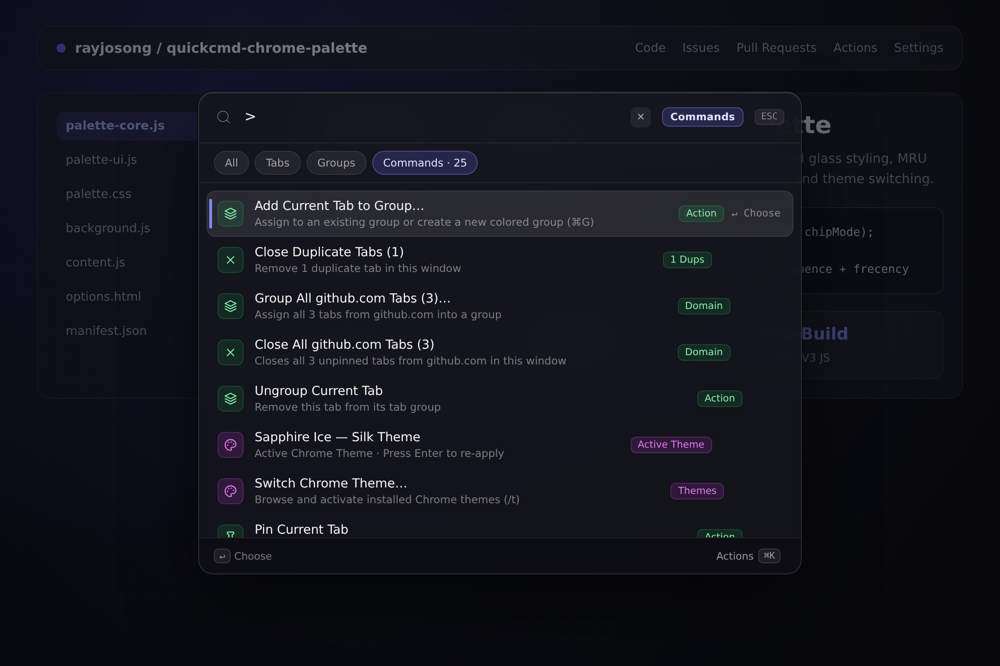

# Favourite Use Cases

A quick guide to the most useful everyday workflows in **Cue — Chrome Command Palette** (`⌘⇧K` / `Ctrl+Shift+K`).

---

## 1. Close Duplicated Tabs

Clean up repeated tabs in your current window without hunting through the tab strip.

- **How to trigger it:**
  1. Open the palette (`⌘⇧K` / `Ctrl+Shift+K`).
  2. Look for **Close Duplicate Tabs** (it automatically surfaces near the top with a count badge like `3 Dups` when duplicates are detected), or type `> close dup`.
  3. Press `Enter`.

- **What it does:**
  - Scans tabs in the current window for duplicate URLs (ignoring `#hash` fragments and trailing slashes).
  - Keeps one copy of each URL and closes the redundant duplicates, leaving pinned tabs intact.

---

## 2. Consolidate Grouped Tabs in One Window & Separate Ungrouped Tabs

Keep your organized tab groups together in one dedicated workspace window while moving loose, unpinned/ungrouped tabs into another window.

- **How to trigger it:**
  1. Open the palette (`⌘⇧K` / `Ctrl+Shift+K`) in the window where you want all your tab groups to live.
  2. Type `consol` (in **All** or **Commands** mode).
  3. Select **Consolidate Groups Here & Separate Ungrouped Tabs** and press `Enter`.

- **What it does:**
  1. Moves all tab groups from other matching normal windows into your current window (preserving group names, colors, and collapsed state).
  2. Moves all unpinned, ungrouped tabs across your matching windows into another window (creating a new window automatically if no other window is open).
  3. Leaves pinned tabs untouched.
