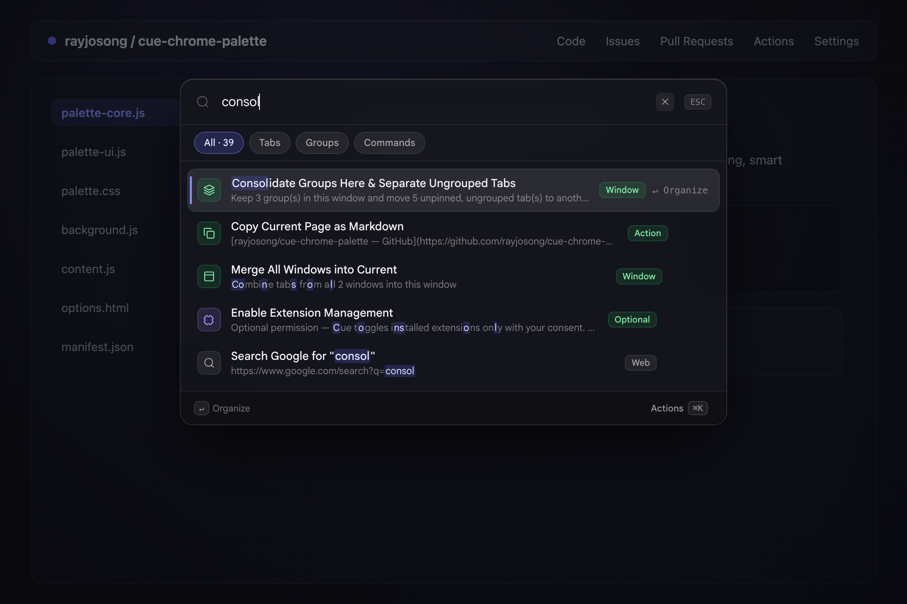

# Favourite Use Cases

A quick guide to the most useful everyday workflows in **Cue — Chrome Command Palette** (`⌘⇧K` / `Ctrl+Shift+K`).

---

## 1. Close Duplicated Tabs

Clean up repeated tabs in your current window without hunting through the tab strip.

- **How to trigger it:**
  1. Open the palette (`⌘⇧K` / `Ctrl+Shift+K`).
  2. Look for **Close Duplicate Tabs** (it automatically surfaces near the top with a count badge like `3 Dups` when duplicates are detected), or type `> close dup`.
  3. Press `Enter`.


- **What it does:**
  - Scans tabs in the current window for duplicate URLs (ignoring `#hash` fragments and trailing slashes).
  - Keeps one copy of each URL (preferring the active or most recently used tab) and closes the redundant duplicates, leaving pinned tabs intact.

---

## 2. Consolidate Grouped Tabs in One Window & Separate Ungrouped Tabs

Keep your organized tab groups together in one dedicated workspace window while moving loose, unpinned/ungrouped tabs into another window.

- **How to trigger it:**
  1. Open the palette (`⌘⇧K` / `Ctrl+Shift+K`) in the window where you want all your tab groups to live.
  2. Type `consol` (in **All** or **Commands** mode).
  3. Select **Consolidate Groups Here & Separate Ungrouped Tabs** and press `Enter`.



- **What it does:**
  1. Moves all tab groups from other matching normal windows into your current window (preserving group names, colors, and collapsed state).
  2. Moves all unpinned, ungrouped tabs across your matching windows into another window (creating a new window automatically if no other window is open).
  3. Leaves pinned tabs untouched.

---

## 3. Auto-Group Ungrouped Tabs by Website

Turn a messy strip of loose tabs into neat, color-coded website groups in a single command.

- **How to trigger it:**
  1. Open the palette (`⌘⇧K` / `Ctrl+Shift+K`).
  2. Type `> auto-group` (or search `auto group` in **All** or **Commands** mode — the action surfaces automatically whenever at least one website has 2+ ungrouped tabs).
  3. Select **Auto-Group Ungrouped Tabs by Website** and press `Enter`.

- **What it does:**
  - Scans unpinned, ungrouped tabs in the current window and clusters them by base domain (`github.com`, `google.com`, `youtube.com`, etc.).
  - Creates a colored Chrome tab group for every website with **2 or more** ungrouped tabs, cycling through Cue's group color palette.
  - Automatically applies clean brand-formatted titles (such as `GitHub`, `Google`, `YouTube`, `GitLab`, `StackOverflow`, `ChatGPT`, `Figma`, `Notion`, or a capitalized domain name).
  - Leaves pinned tabs, already-grouped tabs, internal `chrome://` pages, and single-tab websites untouched.

---

## 4. Copy All Window or Group Tabs as Markdown / Clean URLs

Export an entire research session, PR review set, or tab group straight to your clipboard for notes, documentation, or sharing.

- **How to trigger it:**
  - **All window tabs:** Open the palette and search **Copy All Window Tabs as Markdown** or **Copy All Window Tab URLs** (or type `> copy window`).
  - **Current tab's group:** While on a grouped tab, search **Copy Current Group Tabs as Markdown** or **Copy Current Group Tab URLs**.
  - **Any tab group:** Switch to Groups mode (`/g` or the **Groups** chip), highlight a group, press `⌘K` / `Ctrl+K`, and select **Copy Group Tabs as Markdown**.
  - **Single tab, bookmark, or history item:** Press `⌘K` / `Ctrl+K` on any item for **Copy as Markdown** or **Copy Clean URL** (or `⌘C` / `Ctrl+C` for the raw URL).

- **What it does:**
  - **Markdown exports** format links as a clean bulleted list (`- [Title](url)`), escaping square brackets (`[` / `]`) inside page titles so links stay valid in Obsidian, Notion, or GitHub.
  - **URL exports** (`Copy All Window Tab URLs` / `Copy Current Group Tab URLs` / `Copy Clean URL`) strip common tracking parameters (`utm_*`, `fbclid`, `gclid`, `dclid`, `msclkid`, `mc_cid`, `mc_eid`, `ref_src`, `igshid`, `_hsenc`, `_hsmi`) before copying to the clipboard.

---

## 5. Suspend Idle or Background Tabs (Memory Saver)

Reclaim RAM from inactive tabs without closing them or breaking your tab group layout.

- **How to trigger it:**
  - **Idle tabs:** Open the palette and run **Suspend Idle Tabs** (`> suspend idle` — surfaces near the top with an idle count badge when inactive tabs exist).
  - **All background tabs:** Run **Suspend Other Background Tabs** (`> suspend other`) to sleep every non-active, silent background tab in the current window.
  - **Single background tab:** Highlight any non-active tab in the palette, press `⌘K` / `Ctrl+K`, and choose **Suspend Tab (Save Memory)**.

- **What it does:**
  - Uses Chrome's native `chrome.tabs.discard` API to unload tab memory while keeping tabs visible in place inside the tab strip and inside their existing tab groups.
  - Marks suspended tabs with a `Sleeping` badge in Cue; clicking or switching back to a sleeping tab reloads it automatically.
  - Safely skips the active tab, pinned tabs, audible tabs (playing audio/video), and already-suspended tabs. **Suspend Idle Tabs** uses your configured inactivity threshold from **Options** (default: 1 hour).

---

## 6. Save a Tab Group to a Bookmark Folder

Archive an active project or research tab group into Chrome bookmarks so you can close the tabs now and pick them back up later.

- **How to trigger it:**
  - **Current tab's group:** While viewing a tab inside a group, open the palette and run **Save Current Group to Bookmarks** (`> save group` or `> bookmark group`).
  - **Any tab group:** Type `/g` (or select the **Groups** chip), highlight any tab group, press `⌘K` / `Ctrl+K`, and choose **Save Group to Bookmarks**.

- **What it does:**
  - Collects every `http://` and `https://` tab inside the selected group.
  - Creates a dedicated bookmark folder named `Cue: <Group Name>` (or `Cue Tab Group` if unnamed) and saves all tabs in order.
  - Lets you close the group immediately (via `⌘K` → **Close All Tabs in Group**) and search those saved links anytime later in Bookmarks mode (`*`).

---

## 7. Sort Tabs by Website & Clean Up Tabs to the Right

Bring instant order to a sprawling tab bar or sweep away trailing tabs after a finished task.

- **How to trigger it:**
  - **Sort by website:** Open the palette and run **Sort Tabs by Website** (`> sort tabs`).
  - **Close tabs to the right:** Run **Close Tabs to the Right** (`> close right`) to close tabs after your active tab, or highlight any tab in Cue, press `⌘K` / `Ctrl+K`, and choose **Close Tabs to the Right**.

- **What it does:**
  - **Sort Tabs by Website** arranges all unpinned tabs in the current window alphabetically by base domain (then by page title) right after your pinned tabs, leaving pinned tabs untouched.
  - **Close Tabs to the Right** closes every unpinned tab positioned to the right of the target tab in the current window while preserving pinned tabs.

---

## 8. Split Tabs & Tile View (`Split Tabs…`)

View documentation, code, PRs, or reference pages side-by-side without manually dragging windows around.

- **How to trigger it:**
  1. Open the palette and run **Split Tabs…** (`> split`).
     - *Shortcut for 2 tabs:* Highlight another open tab, press `⌘K` / `Ctrl+K`, and select **Split with Current Tab** (for an immediate 2-tab In-Window Split) or **Add to Split View…**.
  2. The Split Picker starts with your active tab selected (`Pane 1`). Press `Tab` (or click rows) to toggle 2 or more tabs (`Pane 2`, `Pane 3`, …).
  3. Press `⌘L` / `Ctrl+L` (or click a layout button in the top bar) to choose a layout, then press `Enter`.
  4. To separate a native Chrome Split View later, run **Unsplit Current Tab** (or `⌘K` → **Unsplit Tab**).

- **What it does:**
  - **2 tabs:** Supports Chrome's native **In-Window Split** (`chrome.tabs.createSplit`, side-by-side inside the same window when available in your Chrome version), **Side by Side (Win)**, or **Top & Bottom (Win)**.
  - **3 tabs:** Supports **3 Columns** or **1 + 2 Split** (one full-height left pane + two stacked right panes).
  - **4+ tabs:** Supports **2×2 Grid**, **4 Columns**, or **Auto Grid** (for 5+ tabs), automatically reusing your current window and solo-tab windows and tiling panes cleanly within your screen's available work area.

---

## 9. Close or Group All Tabs from a Website & Clean Up Idle Tabs

Batch-manage all tabs belonging to a site (including across subdomains) or prune stale tabs automatically.

- **How to trigger it:**
  - **Group or close by website:** Open the palette on any site with multiple open tabs to surface **Group All `<domain>` Tabs…**, **Close All `<domain>` Tabs**, **Group All `<site>` Website Tabs…**, or **Close All `<site>` Website Tabs**.
  - **Quick keyboard shortcut:** Highlight any tab in Cue and press `⌘⇧⌫` / `Ctrl+Shift+Bksp` to close all unpinned tabs in the current window sharing that website's base domain.
  - **Close idle tabs:** Run **Close Idle Tabs** (`> close idle`) to sweep away tabs inactive past your threshold (configurable in **Cue Options → Idle Tab Cleanup** from `15 minutes` up to `24 hours`; default `1 hour`).

- **What it does:**
  - **Website grouping & closing** recognizes both exact hostnames (e.g., `gist.github.com`) and shared base domains (e.g., grouping or closing `docs.github.com` + `github.com` together under `github.com`), while always preserving pinned tabs.
  - **Close Idle Tabs** closes only unpinned, silent (non-audible) tabs in the current window whose last activity is older than your configured idle timeout.

---

## Development & CI/CD Workflows

Cue uses zero-build Vanilla JavaScript with Node's built-in test runner and GitHub Actions automation:

| Workflow / Config | Trigger | What It Does |
| :--- | :--- | :--- |
| [`.github/workflows/ci.yml`](../.github/workflows/ci.yml) | `push` / `pull_request` to `main` | Runs `node --check` syntax validation on all JS files, runs `node --test tests/*.test.js`, packages `cue-chrome-palette-ci.zip`, verifies all manifest & HTML entry files are present, and uploads the zip artifact. |
| [`.github/workflows/release.yml`](../.github/workflows/release.yml) | Tag push (`v*`) or `workflow_dispatch` | Validates semver against `manifest.json` (and optionally bumps/commits `manifest.json` + creates the tag on dispatch), runs syntax checks & `node --test tests/*.test.js`, packages `cue-chrome-palette-vX.Y.Z.zip`, and creates/updates the GitHub Release. |
| [`.github/workflows/publish-cws.yml`](../.github/workflows/publish-cws.yml) | GitHub Release `published` or `workflow_dispatch` | Packages `cue-chrome-palette-v<version>.zip` and, when `CWS_EXTENSION_ID`, `CWS_CLIENT_ID`, `CWS_CLIENT_SECRET`, and `CWS_REFRESH_TOKEN` secrets are configured, uploads and publishes (or uploads a draft) to the Chrome Web Store. |
| [`.github/workflows/security.yml`](../.github/workflows/security.yml) | `push` / `pull_request` to `main` & weekly Monday `06:00 UTC` | Runs GitHub CodeQL static security analysis for `javascript-typescript`. |
| [`.github/dependabot.yml`](../.github/dependabot.yml) | Weekly schedule | Checks for `github-actions` dependency updates in `.github/workflows/`. |

To run the full test suite locally (requires Node.js):

```bash
node --test tests/*.test.js
```
